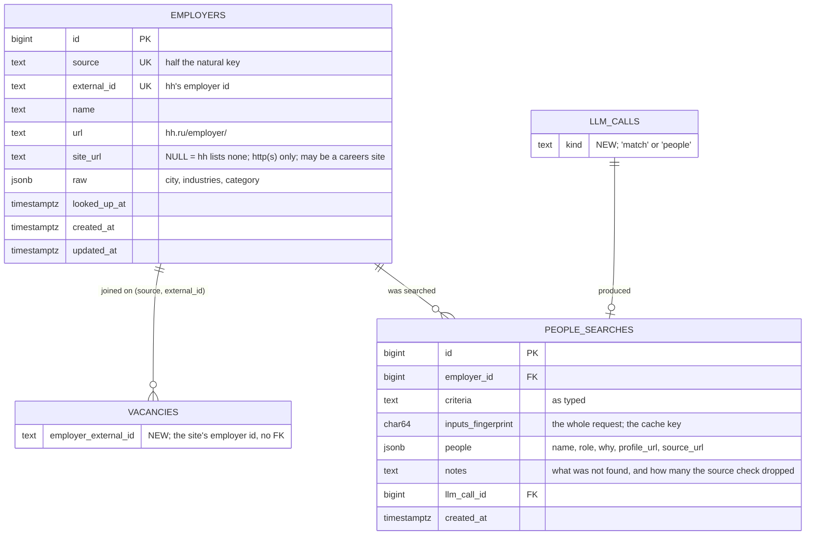

# Company research: website and people to write to

**Slice 1 (the free company lookup) is built, 2026-10-07; slices 2 and 3 are
still a plan** (§10). Reviewed 2026-10-07 by a backend and an architecture
pass; their changes are folded in below, and what they cut is listed in §11.

From a vacancy's detail page the user can ask, on demand, who the employer is
(free: its hh profile and website) and whom to write to (paid: a LangChain agent
searching the web against criteria the user types).

**Nothing here runs in the crawl.** The crawl only keeps one more string it
already parses: the employer's id. Every request to hh or to the model for this
feature starts from a click.

New files are named in plain text until they exist: `tests/test_docs.py` fails
a doc that backticks a `jobmatch/` path which is not on disk.

---

## 1. Where it lives in the UI

The vacancy detail page (`VacancyDetailView.vue`) gets a **Company** card
between *Key skills* and *Cover letter*, shaped like the cover-letter card:
title left, action right, result below. You'd use the company card first and
the letter second.

```
┌ Company ─────────────────────────────────── [Look up company] ┐
│ Okko — the company behind this posting, from its hh profile.  │   before
└───────────────────────────────────────────────────────────────┘

┌ Company ───────────────────────────────────────────────────────┐
│ Okko · okko.tv ↗ · hh profile ↗          looked up 7 Oct        │   after step 1
│                                                                 │
│ People to write to                                              │
│ [ e.g. engineering lead of the Python team           ] [Find]   │   step 2
│                                                                 │
│  Anna K. — Head of Backend               linkedin ↗             │
│    leads the Python platform team    source: okko.tv/team ↗     │
└─────────────────────────────────────────────────────────────────┘
```

- **The two steps are separate** because one is free and takes about 2 s, and
  the other is paid and takes 30–90 s.
- **Results are per company, not per vacancy.** A company has about 2.2
  postings on average (5 553 vacancies, 2 488 companies on 2026-10-06), so
  opening another posting from the same employer shows what was already found,
  with no request.
- **Every person shows the page they were found on.** No source, no person.
- **The Find button is disabled while a search runs.** That alone prevents a
  double-click paying twice; no server-side lock.
- **Links render only when `http`/`https`.** `site_url` is the employer's
  choice and `profile_url` the model's, and Vue does not block `javascript:`.

---

## 2. Flow

```
[Look up company] ── POST /api/vacancies/{id}/company ──────────────── free, ~2 s
                       pipeline.lookup_employer(vacancy_id)
                         1. vacancy has no employer_external_id?
                            → re-fetch its hh page, write that one column only
                         2. source.fetch_employer(id)  → hh.ru/employer/<id>
                         3. repository.upsert_employer → employers row, created here

[Find people] ──────── POST /api/vacancies/{id}/company/people ──────── paid, ~30–90 s
                       pipeline.find_people(vacancy_id, criteria)
                         1. company never looked up? → step 1 first
                         2. build the request, fingerprint it
                         3. a people_searches row with this (employer, fingerprint)?
                            → return the newest, zero cost
                         4. the people module runs the agent
                         5. llm_calls row (kind='people') + people_searches row
```

Both operations live in `jobmatch/pipeline.py`: by `docs/architecture.md` §1 it
is the one module allowed to know sources, the LLM side and the database, and
`lookup_employer` needs a source while `find_people` needs the LLM. Neither
holds a session across a network call, as in `pipeline._fetch`.

### The employer-id backfill (step 1.1)

The vacancies fetched before this feature know the company **name** as text
but not **which** hh employer it is. The stored JSON-LD holds only
`{"name", "@type"}`. A name is not a key: two companies can share one.

So the first lookup on such a vacancy downloads its page again (one request)
and writes **`employer_external_id` only**, in its own short session after the
fetch. It never goes through `repository.apply_fetched`, which would overwrite
the whole row: if the employer had edited the posting, a "look up company" click
would change the content hash and make the next `jobmatch match` pay again.

- `VacancyGone` (404/410, archived) is a positive signal, so it calls
  `repository.mark_delisted`, as `_fetch` does, and the route answers 404
  "posting removed, employer unknown".
- A page with no employer link (anonymous posting, or a branded layout without
  it) answers 404 "this posting does not name its employer".
- One request on a click next to a running crawl needs no throttling logic.

New vacancies get the id in the normal fetch, so the step never runs for them.
Each old vacancy goes through it at most once, and only when clicked. No bulk
backfill.

---

## 3. Database (two migrations, one per slice; §10)



**Slice 1:** `vacancies.employer_external_id`, `employers`.
**Slice 3:** `people_searches`, `llm_calls.kind`.

| Change | Why |
|---|---|
| `vacancies.employer_external_id`, plain text, no FK | Set by `apply_fetched` from what the page already says. The crawl writes no employer row, so there is no upsert in the fetch path, no race between the three fetch workers, and no rule for whose `name` wins. Nothing deletes rows, so an FK would buy nothing. |
| `employers` keyed by `(source, external_id)`, created on lookup only | Same key rule as vacancies. A row exists only for a company someone asked about, so `looked_up_at` is always set and is just "when". |
| `site_url` a column, the rest in `raw` | A company website is not hh-specific and is what the card shows. City, industries and category are hh text kept because the parser returns them; not shown in v1. |
| `people_searches.inputs_fingerprint` | The cache key, by the rule in `docs/architecture.md` §4: fingerprint the request, not the row. Defined in §5. |
| No `vacancy_id`, `model` or `criteria_key` on `people_searches` | `llm_calls.vacancy_id` and `llm_calls.model_requested` already hold the first two, and the fingerprint replaces the third. |
| `people` as JSONB | Nothing sorts or filters on a single person (the §5 rule in `docs/architecture.md`). |
| Index `(employer_id, inputs_fingerprint, created_at DESC)` | The cache lookup. No unique constraint: the table is append-only, like `llm_calls`. |
| `llm_calls.kind`, `NOT NULL` | The market view's spend sums `llm_calls` (`repository.stats`: the no-CV path and the `country` join); without this, people searches would count as matching spend. Added with `DEFAULT 'match'` to fill existing rows (instant on PG 11+), then the default is dropped and `jev._record_call` passes `kind='match'`, so a new caller cannot be silently counted as matching. Plain text, no PG enum. |

This reverses "`companies` table" in `docs/decisions.md` ("nothing joins on
company"): people searches now join on it.

---

## 4. The source seam

| Piece | Where |
|---|---|
| `VacancyData.employer_id` | `jobmatch/sources/__init__.py`. The site's id for the employer; None when hidden. |
| `EmployerData(external_id, url, name, site_url, raw)` | same file |
| `Source.fetch_employer`, optional | same file; None for a site without employer pages |
| employer id from `data-qa="vacancy-company-name"` `href` | `jobmatch/sources/hh/__init__.py` |
| `parse_employer` / `fetch_employer` | same file |

`fetch_employer` sits behind the seam because fetching a page from the site is
site knowledge; pipeline calling `hh.fetch_employer` directly would break the
seam. It does change the documented contract ("a source answers exactly two
questions", `docs/architecture.md` §2), which `decisions.md` once cited to
refuse `Source.describe()`. The difference: `describe()` would have described
the source, and this fetches a third kind of page from it. Record that in
`decisions.md` and amend §2.

Parsing, verified 2026-10-07 on three employers (Okko, Яндекс, СБЕР): the name
is `company-header-title-name` and the site is the `href` of
`sidebar-company-site`. For Яндекс and СБЕР that site is a careers page, not the
homepage. hh's JSON API (`api.hh.ru/employers/<id>`) answers 403 without an
OAuth app, so the HTML is the only way in.

Fixes to the uncommitted diff (backend review):

- **Stub detection like `_is_real_page`.** The throttling stub has no `data-qa`
  markers at all. A real page that lacks the name marker raises `ParseError`
  rather than being retried as "throttled" for 18 s.
- **A 404 from `fetch_employer`** surfaces as a 404 response, not a 502.
- **`site_url` kept only when `http`/`https`.**

---

## 5. The agent (new module: people.py in jobmatch/)

The only module that imports LangChain, as `matching/jev.py` is the only one
that knows the Jev SDK.

### Surface, so LangChain can be swapped out

```python
@dataclass(frozen=True, slots=True)
class Brief:          # the company, never the vacancy: results are per company
    name: str
    site_url: str | None
    hh_url: str

@dataclass(frozen=True, slots=True)
class Person:         # no email, no phone: role-level public facts only
    name: str
    role: str
    why: str
    source_url: str
    profile_url: str | None

@dataclass(frozen=True, slots=True)
class Found:
    people: list[Person]
    notes: str
    dropped: int      # removed by the source check

def fingerprint(brief: Brief, criteria: str, model: str) -> str
async def find(brief: Brief, criteria: str, model: str, *, vacancy_id: int) -> tuple[Found, int]
    # -> (result, llm_call_id), the ledger row already committed in its own session
```

`web_search` and `read_page` are plain async functions. Only one private
function, `_agent()`, wraps them as LangChain tools and calls `create_agent`.
Replacing LangChain with a ~100-line `httpx2` tool loop would touch that
function alone.

### The pieces

| Part | Choice |
|---|---|
| Model | `ChatOpenAI` pointed at OpenRouter, using the existing `OPENROUTER_API_KEY` |
| Model id | `research_model = "openai/gpt-oss-120b"` in `config.toml`, pinned. The cheapest listed model with both tool calls and structured output on 2026-10-07: $0.037 / $0.17 per million input / output tokens. |
| Agent | `create_agent(model, tools, system_prompt=…, response_format=ToolStrategy(...))`, with a `recursion_limit` (step cap) and a ~180 s timeout |
| Tracing | LangSmith tracing switched off in code. An inherited `LANGCHAIN_TRACING_V2` / `LANGSMITH_TRACING` would otherwise send prompts and third parties' names to a SaaS. |
| `web_search(query)` | DuckDuckGo through `ddgs` (no key), in `asyncio.to_thread`, up to 8 results. **Errors return as text** to the model: ddgs rate-limits often, and one failed search must not kill a paid run. |
| `read_page(url)` | `httpx2` streaming, stops at ~2 MB, `text/html` only, a timeout, parsed in `to_thread`, text capped at ~8k characters. `http`/`https` only; the host must resolve to a public address (`ipaddress…is_global`), with redirects re-checked per hop. Your own API on `localhost:8000` serves CV-derived data, and search results can carry prompt injection. Never fetches LinkedIn: a LinkedIn URL can only come from search results. Errors return as text. |
| Prompt | the `Brief` and the criteria; search in Russian and English; every person needs a source; never guess; collect no email or phone |
| Source check | Tools record every URL they return. A person is kept only if `source_url` was seen, and `profile_url` too when given; URLs normalised on both sides (scheme, trailing slash, `utm_*`). A run where every person is dropped is still stored, with `dropped` in `notes`: it was paid for. |

### Fingerprint and ledger

- **`inputs_fingerprint`** = sha256 of the system prompt, the rendered user
  prompt (Brief + criteria), the tool schemas, the output schema and the model.
  Editing the prompt, a tool or the schema invalidates the cache, and so does a
  changed `site_url`, with no version constant. The same value goes on
  `llm_calls.inputs_fingerprint` (NOT NULL) and on
  `people_searches.inputs_fingerprint`.
- **Cost accumulates per model call**, from `response_metadata["token_usage"]`
  (tokens and OpenRouter's `cost`). The final result is not the source of the
  sum, because a run that fails or times out still spent money.
- **One `llm_calls` row per agent run** (`kind='people'`), written in `finally`
  in its own session. That catches a client disconnect too: Starlette cancels
  the handler with `CancelledError`, which `except Exception` skips (the trap
  the `pipeline._drain` docstring describes).

Checked offline on 2026-10-07 against a mocked OpenRouter transport:
LangChain 1.4.3's `create_agent` with `ToolStrategy` returns the typed result,
and `cost` survives into the message metadata. Whether the live API sends
`cost` is still to confirm (§10, slice 2).

### Trying it without the UI

`python -m jobmatch.people "<company>" "<criteria>"` prints what it found and
writes nothing (precedent: `python -m jobmatch.sources.hh`). It still pays.

---

## 6. API (`jobmatch/api/routers/company.py`)

| Route | Returns |
|---|---|
| `GET /api/vacancies/{id}/company` | `Company \| null`: what is stored, plus the newest people search; no network |
| `POST /api/vacancies/{id}/company` | `Company`: looks it up (again). 404 for an anonymous or removed posting or a missing employer page, 502 when hh fails otherwise |
| `POST /api/vacancies/{id}/company/people` `{criteria}` | `PeopleSearch`: cached when the fingerprint matches. 502 when the agent fails |

Response models in `jobmatch/api/schemas.py`, projections like the rest:

- `Company{name, hh_url, site_url, looked_up_at, people: PeopleSearch | null}`
- `PeopleSearch{criteria, people[], notes, created_at, cost_usd}`

The two POST routes take no `SessionDep`: `pipeline.*` opens its own short
sessions, so no pooled connection is held for up to 180 s. (The cover-note route
does hold one; not changed here.)

---

## 7. Frontend

- `CompanyPanel.vue` in `src/components/`, placed in `VacancyDetailView.vue` as
  in §1. It loads stored data on open (`GET`) and shows the button otherwise.
- Criteria: one free-text field with a placeholder example.
- The Find button is disabled while the request runs.
- Links render only when `http`/`https`.
- `src/api/types.ts` (the contract), `client.ts`, `mock.ts`.

---

## 8. Tests (no real hh or LLM call)

- **hh parsing:** employer id from a vacancy page; `parse_employer` on a
  minimal fixture; the stub page returns None; a real page without the name
  raises `ParseError`; a `javascript:` site is dropped.
- **The people module:** the source check (seen / unseen / normalised URLs,
  `profile_url`); the fingerprint changes with each input; `read_page` refuses
  private addresses and non-HTML; tool errors come back as text; the agent loop
  on a mocked OpenRouter transport; the ledger row is written on failure and on
  cancellation, with the accumulated cost.
- **API, real database:** lookup with `fetch_employer` stubbed; the backfill
  writes `employer_external_id` and leaves `description` and `content_hash`
  untouched; `VacancyGone` during the backfill marks the vacancy delisted and
  answers 404; an anonymous posting answers 404; a people cache hit spends
  nothing.
- **Repository:** spend in `repository.stats` excludes `kind='people'`.

---

## 9. Docs to update when it is built

- `docs/decisions.md`:
  - the `companies` table, reversed, and why;
  - `Source.fetch_employer` and how it differs from the refused `describe()`;
  - LangChain adopted for people search only, behind the surface in §5, with
    Jev staying on its own SDK; the trade-off accepted (langgraph, langsmith,
    the `websockets<17` pin);
  - DuckDuckGo over Tavily (no key);
  - `people_searches` holds personal data about third parties: no contact
    fields, LangSmith off, and "nothing deletes rows" is about vacancies, not
    about it.
- `docs/architecture.md`: §2 (the seam's third operation), §3 (the new tables),
  §7 (pipeline also holds two on-demand operations), §11 (the routes).
- `docs/pipeline.md`: the two on-demand operations.
- `CLAUDE.md`: the layout gains the people module.
- This file: backtick the new paths once they exist.

---

## 10. Build order

1. **Free slice — built 2026-10-07.**
   - Fix the uncommitted hh diff (§4).
   - Migration: `vacancies.employer_external_id`, `employers`.
   - `pipeline.lookup_employer` with the id-only backfill.
   - `GET`/`POST /company`.
   - The Company card with the website and hh profile links.
   - The `decisions.md` and architecture entries that slice needs.
2. **Agent offline.** The people module and its `__main__`. Run it on 3–5 real
   companies, which judges `gpt-oss-120b` and confirms the live API returns
   `cost`, before any UI is built on it. Quality is the plan's biggest unknown.
3. **Paid slice.**
   - Migration: `people_searches`, `llm_calls.kind`.
   - The `repository.stats` filter.
   - `pipeline.find_people`, the people route, the people list in the card.
   - The remaining tests and docs.

---

## 11. Deferred or cut, and why

| Not in v1 | Why |
|---|---|
| Preset criteria chips | Free text covers them; add if the same phrases keep being typed. |
| A history of searches per company, a `refresh` flag | The fingerprint already re-runs when the prompt, model, site or criteria change. Add refresh if stale results turn out to matter. |
| Showing city and industries | Stored in `employers.raw`; nothing in the card needs them yet. |
| "The person's surname must appear on the source page" | Transliteration breaks it ("Anna K." vs "Анна Кузнецова"), so it would silently drop real people. The URL check plus a visible source link is enough until invented names actually show up. |
| A background job and polling | A 30–90 s synchronous POST matches the cover note. Results land in the database, so moving to a background task later is cheap. |
| A delete endpoint for people searches | Single user, local database. Revisit with any hosted version. |
| A bulk employer-id backfill | Each old vacancy fills in on its first click. |

---

## 12. Open points

1. **Branded vacancy pages** may not carry the employer link; those vacancies
   answer "does not name its employer" and there is no fallback.
2. **`gpt-oss-120b` quality** on OpenRouter depends on which upstream provider
   serves it. If results are poor, changing `research_model` is the only edit.
3. **Dependencies:** adding LangChain pins `websockets` below 17
   (`langgraph-sdk`, `langsmith`). Nothing in the app uses websockets.
